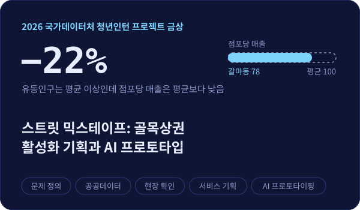

<div align="center">

<a href="https://git.io/typing-svg"></a>


<a href="mailto:pink120312@gmail.com"></a>
<a href="mailto:pink6919@naver.com"></a>
<a href="tel:010-0000-0000"></a>

</div>

<br>


## 🙋‍♀️ About me

```python
>>> seungyeon.info()

name         최승연 (Seungyeon Choi)
role         Data Analyst
education    부산대학교 미디어커뮤니케이션학과 졸업 (빅데이터 융합 트랙 이수)
experience   국가데이터처 인구추계팀 청년인턴 (2026.03 – 2026.08)
strength     직접 모은 데이터로 문제를 정의하고, 결과를 끝까지 다시 검증
now          지난 분석을 Python으로 재현 · 검증하며 코드로 정리하는 중
             머신러닝 모델링 · 평가 역량 확장 중
```

<br>

## 🛠️ Skills & tools

<!-- 뱃지 색 바꾸기: 각 주소의 -3776AB? 처럼 이름 뒤 6자리 색상코드만 바꾸면 됩니다 -->
<table>
<tr>
<th>Languages</th><th>Libraries</th><th>Methods</th><th>Tools & data</th>
</tr>
<tr>
<td valign="top">
<br>
<br>

</td>
<td valign="top">
<br>
<br>
<br>

</td>
<td valign="top">
<br>
<br>
<br>

</td>
<td valign="top">
<br>
<br>
<br>
<sub>KOSIS · 한국관광데이터랩 · 소상공인 상권정보</sub>
</td>
</tr>
</table>

<br>

## 💼 Experience

### 국가데이터처 인구추계팀 청년인턴 &nbsp;<sub>`2026.03 – 2026.08`</sub>

**AI 기반 인구추계 고도화 사업 (출생 · 사망 · 국제이동)** &nbsp; `R` `Python` `LSTM` `Transformer`

> 전년도에 처음 시작된 사업의 첫 인턴으로 투입. 담당 주무관도 새로 발령받아 **가이드 없이 전년도 보고서와 데이터만으로** 출발해야 하는 상황

- **결과를 내는 데서 멈추지 않고 원리를 역추적** — 기존 코드를 그대로 실행하는 대신 원천 데이터 · 코드 · 최종 보고서를 처음부터 대조
- **전년도 산출물의 불일치 발견** — 주석과 실제 코드가 다른 부분을 바로잡고, 보고서에는 공변량 18개로 적혀 있으나 실제 데이터에는 10개만 있음을 확인
- **"공변량을 넣으면 정확도가 오른다"는 전제를 직접 검증** — 출생 5년 예측 RMSE가 공변량 미반영 모델 **0.070**로 반영 모델 **0.092**보다 낮았고, 사망도 공변량 반영 시 오차가 약 0.01 증가. 추가 변수가 오히려 노이즈로 작용할 수 있음을 수치로 확인
- 오차 원인을 **공변량과 파라미터로 나눠 점검** — 국제이동이 공변량에 특히 민감하고, 출생은 코로나 시기(2020년)가 검증 구간에서 학습 구간으로 넘어가며 예측이 달라짐을 확인
- 연령 구간 기준이 달라진 데이터를 다시 정제하고, 학습 · 검증 구간을 1년씩 옮겨 5년 · 10년 예측 기간을 확장 (출생 5년: 학습 1980–2020, 검증 2021–2025)
- 찾아낸 불일치와 수치로 검증한 모델 개선 방향을 부서 연구회에서 [**단독 발표 📎**](docs/population-projection-presentation.pdf)
<br>

## 🏆 Achievements


<br>

## 📂 Projects

<table>
<tr>
<td width="50%" align="center"><a href="https://github.com/sseungyeonn/subway-transfer-accessibility"></a><br><sub>*이미지를 누르면 프로젝트로 이동합니다</sub></td>
<td width="50%" align="center"><a href="https://github.com/sseungyeonn/street-mixtape"></a><br><sub>*이미지를 누르면 프로젝트로 이동합니다</sub></td>
</tr>
</table>


**인턴 프로젝트 금상 공동 수상 과제** &nbsp;<sub>4인 팀이 3개 과제를 동시에 수행해 종합 평가로 수상</sub>

| 과제 | 내용 |
|:--|:--|
| 법정최고금리 인하가 가계의 금융행태에 미치는 영향<br><sub>데이터 전처리 담당</sub> | 가계금융복지조사 패널(2015–2019)과 이중차분법으로 2018년 최고금리 인하(27.9%→24%)가 고금리 차주의 상환 행태와 부채에 미친 영향 분석 |
| 청년 삶의 질 종합지수 개발<br><sub>서론 · 결론 작성 담당</sub> | 「청년 삶의 질 2025」 62개 지표 중 41개를 선별 · 결측 보정 · 정규화하는 종합지수 **산출 방법을 설계 · 제안**하고, 개인 진단과 맞춤 정책 추천 서비스로의 확장 방안 제시 |


**그 밖의 프로젝트**
- **공식 연설문 vs 유튜브 댓글 언어 구조 비교** — 공식 연설문은 LDA 토픽 모델링으로 핵심 키워드 구조를 도출하고, 유튜브 댓글 약 47만 건은 KOTE(43개 감정) · 적대성 점수로 정량화해 채널 운영 방식(스튜디오 논평형 vs 현장 중계형)에 따른 감정 강도 차이를 t-검정으로 검증 (개인 프로젝트, 2025.04–12)<br>`Python` `KoNLPy` `PyTorch` `YouTube API` `LDA` `감성분석`
- **빅카인즈 뉴스 데이터 LDA 토픽 모델링** — 지역 언론과 중앙 언론의 보도 프레임 비교 (수업 프로젝트)
